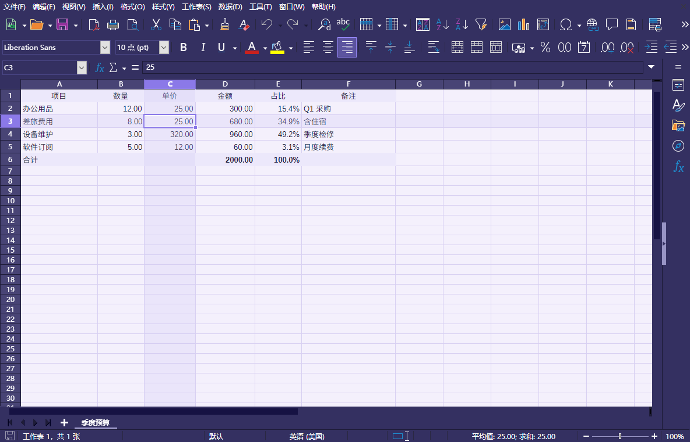

# Violet Dusk — LibreOffice 深紫外壳 + 浅紫画布

**简体中文** · [English](README.en.md)

给 **LibreOffice 25.2+** 用的界面主题：外壳深紫 `#343061` 配纯白文字，文档画布浅紫 `#F4F1FD` 配深墨文字，Calc 的行列定位框用 `#8B79E8`，三者同属紫罗兰色系。

打包为标准 `.oxt` 扩展，双击即装；另附同色系 `.soc` 调色板，供文档取色使用。



*深紫外壳 `#343061` + 浅紫画布 `#F4F1FD`；C3 单元格显示 `#8B79E8` 定位框与同色系行列十字高亮*

```
界面外壳  AppBackground / WindowColor / FaceColor   #343061
菜单栏    MenuBarColor                              #343061
导航文字  MenuBarTextColor / WindowTextColor        #FFFFFF
单元格    DocColor                                  #F4F1FD
网格线    CalcGrid                                  #D9D1F2
正文      CalcText / FontColor                      #241F3D
定位框    CalcCellFocus                             #8B79E8
```

## 安装

**方式一：双击导入（推荐）**

1. 完全退出 LibreOffice（含托盘里的快速启动器，任务管理器里不应残留 `soffice.bin`）
2. 双击 `dist/Violet-Dusk-1.1.0.oxt`，用 LibreOffice 打开，确认安装
3. 重启 LibreOffice
4. `工具 → 选项 → LibreOffice → 外观` → 主题下拉选 **Violet Dusk**，勾选「启用应用程序主题」

**方式二：命令行**

```bash
# Windows
"C:\Program Files\LibreOffice\program\unopkg.exe" add "Violet-Dusk-1.1.0.oxt"

# Linux / macOS
unopkg add Violet-Dusk-1.1.0.oxt
```

扩展内部不含任何绝对路径，可跨机器部署；新配置环境下会自动选中本主题。

**调色板（可选）**

`工具 → 选项 → LibreOffice → 颜色 → 打开`，选择 `dist/Violet-Dusk-palette.soc`。之后在单元格背景、字体颜色、图表配色等所有取色面板里都能直接选到这套 23 色。

## 配置项参考

所有颜色挂在同一条配置路径下，值是 RRGGBB 的十进制整数：

```
org.openoffice.Office.UI / ColorScheme / ColorSchemes / Violet Dusk / <条目> / Color
```

### 界面

| 条目 | 作用 | 值 |
|---|---|---|
| `AppBackground` | 应用背景、文档四周 | `#343061` |
| `WindowColor` | 窗口、工具栏底色 | `#343061` |
| `FaceColor` | 工具条、对话框面 | `#343061` |
| `BaseColor` | 基础控件底色 | `#343061` |
| `MenuBarColor` | 菜单栏底色 | `#343061` |
| `MenuColor` | 下拉菜单底色 | `#2C2953` |
| `MenuBarTextColor` | 菜单栏文字 | `#FFFFFF` |
| `MenuTextColor` | 下拉菜单文字 | `#FFFFFF` |
| `WindowTextColor` | 工具栏、窗口文字 | `#FFFFFF` |
| `MenuBarHighlightColor` / `MenuHighlightColor` | 悬停、选中块 | `#4A4494` |
| `ActiveColor` | 按钮悬停 | `#423D7A` |
| `SeparatorColor` | 分隔线、边框 | `#4A4685` |
| `DisabledTextColor` | 禁用文字 | `#8B87B8` |
| `AccentColor` | 强调色 | `#9B8CFF` |

### 文档与单元格

| 条目 | 作用 | 值 |
|---|---|---|
| `DocColor` | 单元格 / 纸张底色 | `#F4F1FD` |
| `DocBoundaries` / `TableBoundaries` | 对象、表格边界 | `#D9D1F2` |
| `CalcGrid` / `DrawGrid` | 网格线 | `#D9D1F2` |
| `CalcText` / `FontColor` | 单元格文字 / 正文 | `#241F3D` |
| `CalcValue` | 数值 | `#1F5AA8` |
| `CalcFormula` | 公式 | `#1F7A4C` |
| `CalcReference` | 引用标识 | `#A8387F` |
| `CalcCellFocus` / `CalcDBFocus` | 单元格定位框 | `#8B79E8` |
| `CalcNotesBackground` / `CalcProtectedBackground` | 批注、受保护区域 | `#E9E3FA` |
| `Links` / `LinksVisited` | 链接 / 已访问链接 | `#1F5AA8` / `#6C4FC9` |
| `Author1`–`Author9` | 批注作者色 | 同色系深色变体 |

完整 93 项见 `Theme.xcu`（由脚本生成），与 LibreOffice 26.8 的 `UI/ColorScheme` schema 逐项一致。

## 对比度（WCAG 2.1）

| 前景 / 背景 | 用在哪 | 对比度 |
|---|---|---|
| `#241F3D` / `#F4F1FD` | 单元格、正文 | **14.08:1** |
| `#FFFFFF` / `#343061` | 菜单栏、工具栏 | **12.06:1** |
| `#1F5AA8` / `#F4F1FD` | 数值、链接 | 6.11:1 |
| `#6B5A00` / `#F4F1FD` | 字符串 | 6.10:1 |
| `#B3362F` / `#F4F1FD` | 拼写 / 错误 | 5.41:1 |
| `#A8387F` / `#F4F1FD` | 引用 | 5.33:1 |
| `#1F7A4C` / `#F4F1FD` | 公式 | 4.78:1 |
| `#8B79E8` / `#F4F1FD` | 定位框（图形元素） | 3.14:1 |

## 从源码构建

只需要 Python 3（无第三方依赖）：

```bash
python build-violet-dusk-theme.py
```

输出到 `dist/Violet-Dusk-<版本>.oxt`、`dist/Violet-Dusk-palette.soc` 和 `docs/导入说明.txt`。

改配色就动脚本顶部的三个字典：`UI`（外壳）、`DOC`（文档画布）、`IDE`（Basic IDE），改完记得同步 `THEME_VERSION`。

## 已知限制

- **`DocColor` 是全局文档背景**，改它会影响 Calc 单元格、Writer 纸张、Draw 页面。LibreOffice 主题框架没有单独的「Calc 单元格背景」项。
- 外观页里 **不要勾「使用白色文档背景」**，否则画布被强制刷白，浅紫失效。
- 开启系统级**高对比度模式**会覆盖全部自定义颜色。
- 需要 **LibreOffice 25.2+**。更早的版本没有新的 Appearance 主题框架，装上也不会出现在主题下拉里。
- Basic IDE 保持深色（`#2B2852`），代码编辑器不适合浅底。

## 发布

打 tag 会触发 GitHub Actions，自动构建并把 `.oxt` / `.soc` 挂到 Release：

```bash
git tag v1.1.0 && git push origin v1.1.0
```

若该 tag 的 Release 已存在，工作流会自动跳过，避免产生重复产物。

## License

MIT（见 `LICENSE`）。配色与实现均为本项目原创。

---

[English version →](README.en.md)
